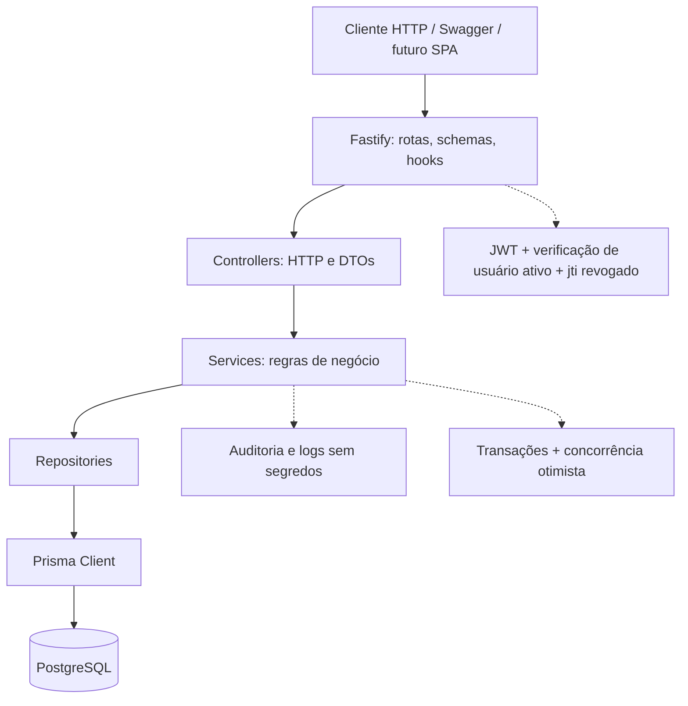
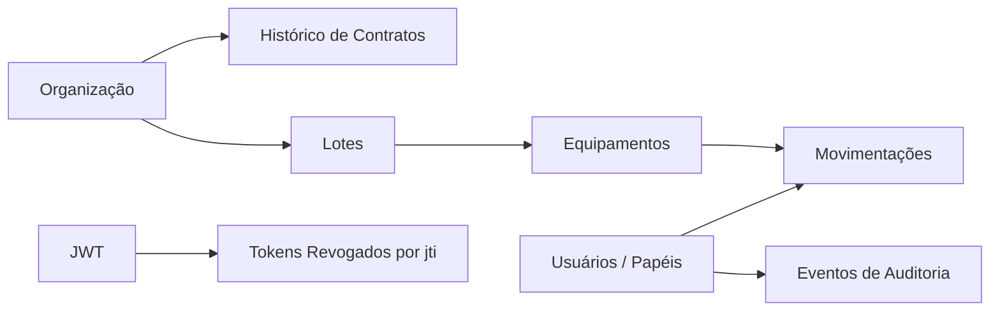
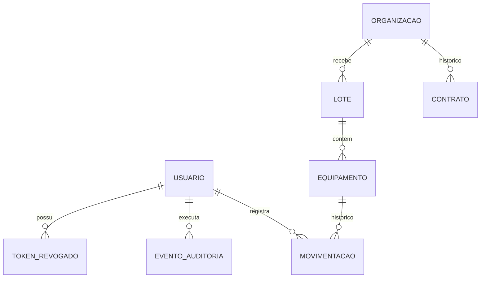

> **Nota de estado (20/10/2026):** este caderno é um retrato da etapa de pré-implementação. As decisões pendentes foram fechadas na confirmação do responsável e consolidadas em `docs/adr/ADR-0002-decisoes-dominio.md`. Use o ADR como fonte de verdade para as escolhas aprovadas; as User Stories não concluídas continuam no backlog.

# GreenCode AV2 — Visão total e caderno de decisões pré-implementação

**Versão:** 1.0 · **Data:** 20/10/2026  
**Repositório:** `C1dneve/TP_GreenCode_AV2`  
**Branch de trabalho:** `feature/av2-monolith`  
**Estado atual:** fundação do servidor e CI concluídas; decisões REST R1–R12 respondidas; decisões de domínio, schema e escopo ainda precisam ser fechadas.

> **Objetivo deste caderno:** dar uma visão integral do que será construído e registrar as decisões necessárias antes de criar o schema Prisma definitivo e implementar os fluxos de negócio. As recomendações são propostas para acelerar a decisão; só ficam aprovadas quando você as confirmar.

## Como preencher

- Responda usando os códigos `ER`, `NEG`, `SEG`, `REL` e `ENT` abaixo.
- Em questões com alternativas, indique a letra. Onde houver texto livre, indique o valor ou comportamento escolhido.
- Você pode responder **“aceito todas as recomendações, exceto: …”** e listar apenas as exceções.
- Se uma questão for irrelevante para o escopo, responda `FORA DE ESCOPO` — mas registre isso como uma decisão de escopo, não deixe em branco.
- `[FECHADO]` significa que já foi aprovado em conversas anteriores. `[PENDENTE]` precisa de sua resposta. `[RECOMENDADO]` é a sugestão técnica inicial, ainda não aprovada.

---

## Navegação rápida

1. Resumo executivo e escopo.
2. Decisões já aprovadas.
3. Arquitetura e fluxo de domínio.
4. Módulos, entregas e prioridades.
5. Entidades e relacionamentos.
6. Perguntas ER/Prisma.
7. Regras operacionais de negócio.
8. Segurança e contrato operacional.
9. Detalhes REST restantes.
10. Testes e critérios de pronto.
11. Cronograma de seis dias + testes.
12. Folha rápida para enviar as respostas.
13. Decisões bloqueadoras antes do schema.

---

## 1. Resumo executivo do produto

A AV2 transforma o GreenCode em um **monólito HTTP com API REST**, persistência relacional e autenticação para vários usuários. A interface completa SPA não é obrigatória nesta etapa: a API deve poder ser validada por Swagger/OpenAPI, ferramentas HTTP e testes automatizados.

### O que a solução precisa entregar

1. API REST versionada e documentada, com validação de entrada e erros uniformes.
2. Autenticação JWT, usuários, os quatro papéis já definidos e autorização aplicada no servidor.
3. CRUD e ciclo de vida de organizações, contratos, lotes e equipamentos, respeitando regras de negócio.
4. Histórico de movimentações sem apagamento silencioso.
5. PostgreSQL com schema Prisma, migrations reproduzíveis, integridade referencial e seed de desenvolvimento.
6. Transações nas operações relacionadas, concorrência otimista nos registros mutáveis e auditoria conforme escopo confirmado.
7. Testes automatizados, CI, README, `.env.example`, ADRs e evidências reais de execução nos sistemas exigidos.

### O que não faz parte do escopo aprovado

- Não reutilizar o histórico Git da AV1 nem desenvolver dentro do repositório AV1.
- Não copiar a pasta `data/`, chaves, `.env`, credenciais ou dados criptografados da AV1.
- Não migrar automaticamente credenciais SHA-256/arquivos de sessão da AV1 para o banco novo. Credenciais novas devem ser armazenadas com hash adaptativo.
- Não desenvolver uma SPA completa nesta etapa, salvo decisão nova explícita.

## 2. Decisões que já estão fechadas — não responder novamente

### Arquitetura e ambiente

- [FECHADO] Node.js + TypeScript + Fastify.
- [FECHADO] Arquitetura Controller → Service → Repository; Controllers não acessam Prisma diretamente.
- [FECHADO] PostgreSQL + Prisma ORM.
- [FECHADO] Repositório AV2 separado, branch de trabalho `feature/av2-monolith`.
- [FECHADO] CI no GitHub Actions com Ubuntu e PostgreSQL; fundação inicial já passa nos testes e no build.
- [FECHADO] API HTTP como foco; SPA completa fora do escopo inicial.

### Segurança e domínio já acordados

- [FECHADO] Papéis iniciais: `ADMINISTRADOR`, `OPERADOR_CADASTRO`, `GESTOR_ALMOXARIFADO`, `AUDITOR`, usando a matriz RBAC aprovada anteriormente.
- [FECHADO] JWT com validade de 30 minutos, verificação do usuário ativo nas requisições protegidas e revogação imediata pelo `jti` persistido.
- [FECHADO] Hash adaptativo de novas senhas (bcrypt); nunca devolver hash, token revogado ou segredo.
- [FECHADO] Transações nas operações que atualizam dados relacionados.
- [FECHADO] Controle otimista de concorrência para impedir atualização perdida; falta apenas fechar os detalhes finais no contrato de escrita.
- [FECHADO] Organização tem relacionamento `1:N` com Contrato, com histórico preservado e **no máximo um contrato vigente por vez**. Essa decisão diverge da simplificação do PDF e deve ser explicada em ADR.
- [FECHADO] Preservar histórico com desativação/cancelamento, sem exclusões físicas destrutivas de entidades com histórico.
- [FECHADO] OpenAPI/Swagger, README, `.env.example`, ADRs, seed e testes fazem parte da entrega.
- [FECHADO] Dia 7 reservado para testes; dias 1–6 para implementação.

### Contrato REST R1–R12 já respondido

| Decisão | Resultado aprovado |
|---|---|
| Prefixo | `/api/v1` |
| Recursos | Plurais em português: `/organizacoes`, `/contratos`, `/lotes`, `/equipamentos`, `/movimentacoes` |
| Identificadores | UUID como chave técnica |
| Resposta | Objeto direto para item; `{ data, meta }` para coleção paginada |
| Erros | `{ error: { code, message, details?, requestId? } }` |
| Paginação | `page`, `pageSize`, `sortBy`, `sortOrder`; padrão 20, máximo 100 |
| Filtros | Por entidade, conforme o contrato REST proposto |
| Contratos | Modelo híbrido: criação/listagem contextual sob organização e acesso por `/contratos/:id` |
| Transições | `PATCH` para campos editáveis; `POST` para ações críticas explícitas |
| Exclusão | Desativação/cancelamento; não apagar fisicamente histórico |
| Autenticação | `/auth/login`, `/auth/logout`, `/auth/me`, `/auth/change-password` |
| Status HTTP | `200`, `201`, `204`, `400`, `401`, `403`, `404`, `409`, `500`; sem `422` no escopo inicial |

O detalhe de payloads e endpoints está em **GreenCode_AV2_Contrato_REST_Proposto.md**. Este caderno evita reabrir essas doze escolhas.

## 3. Visão arquitetural completa

### Arquitetura proposta



**Regra de dependência:** Controllers validam/interpretam HTTP e chamam Services. Services orquestram regras e transações. Repositories encapsulam operações Prisma. Os modelos de domínio não devem depender do Fastify.

### Fluxo operacional principal



Relacionamentos de referência: Organização `1:N` Contrato; Organização `1:N` Lote; Lote `1:N` Equipamento; Equipamento `1:N` Movimentação. Usuário é associado às ações relevantes. O modelo de auditoria, parâmetros e revogação é proposto para fechar as necessidades transversais e deve ser confirmado abaixo.

## 4. Módulos, entregas e prioridades

A proposta abaixo conserva os 9 épicos e 41 User Stories do backlog existente. `P0` representa o núcleo funcional; `P1` representa cobertura complementar/qualidade e deve ter prioridade explícita para caber no prazo.

| Épico | Módulo | Resultado esperado |
|---|---|---|
| E0 | Fundação HTTP | Inicialização segura, configuração, validação, erros e camadas separadas |
| E1 | Banco e Prisma | Modelos, relações, constraints, migrations, conexão e seed |
| E2 | Autenticação e usuários | Login/logout, JWT, revogação, RBAC e gestão da conta |
| E3 | Organizações | Criar, consultar, pesquisar, atualizar, desativar/reativar |
| E4 | Contratos | Histórico, vigência, renovação, cancelamento e regras por organização |
| E5 | Lotes | Entrada, pesquisa, triagem, encaminhamento e finalização |
| E6 | Equipamentos | Cadastro, código interno, atributos, estados físico/rastreamento e cálculos |
| E7 | Movimentações | Registro append-only e histórico cronológico por equipamento |
| E8 | Auditoria, relatórios, parâmetros e entrega | OpenAPI, testes, README, relatórios e parâmetros se confirmados no escopo |

### Priorização que precisa de sua confirmação

- [PENDENTE] Os 4 módulos centrais (Organizações, Contratos, Lotes, Equipamentos) e Movimentações devem preservar todo o comportamento essencial da AV1.
- [PENDENTE] Auditoria, relatórios e parâmetros globais continuam fazendo parte da entrega funcional, ou parte desses itens poderá ser simplificada se ameaçar o prazo?
- [RECOMENDADO] Não cortar integridade, autenticação, RBAC, histórico, transações ou testes dos fluxos críticos para conseguir incluir relatórios avançados. Se for necessário reduzir, reduzir primeiro o formato/variedade dos relatórios, não a segurança ou a consistência.

**ENT1 — Escopo de entrega**
- A. [RECOMENDADO] Todos os fluxos essenciais da AV1; relatórios e parâmetros básicos inclusos; relatório financeiro avançado pode ser simplificado e documentado.
- B. Todos os épicos e User Stories, inclusive recursos P1, sem cortes.
- C. Núcleo P0 apenas; itens P1 excluídos formalmente e documentados.
- **Sua decisão:** `ENT1-____`.

**ENT2 — Front-end**
- [FECHADO] Sem SPA completa nesta AV2. A validação será via Swagger/OpenAPI, testes e cliente HTTP.
- Se precisar alterar isso, especifique o motivo/escopo: `________________`.

## 5. Mapa de entidades e relacionamentos proposto

Este mapa é candidato ao schema Prisma, não o schema definitivo. Os campos com `?` indicam nulabilidade/decisão ainda a confirmar.

### Entidades centrais

| Entidade | Campos candidatos e responsabilidade | Ponto de decisão |
|---|---|---|
| `Usuario` | `id`, `username`, `nome`, `senhaHash`, `papel`, `ativo`, `ultimoAcesso?`, `createdAt`, `updatedAt`, `versao` | Normalização do login, bootstrap do admin, reset e política de senha |
| `Organizacao` | `id`, `razaoSocial`, `cnpj`, `inscricaoEstadual?`, `enderecoCompleto?`, `telefone?`, `email?`, `dataCadastro`, `ativo`, timestamps, `versao` | Obrigatoriedade e campos de endereço/contato |
| `Contrato` | `id`, `organizacaoId`, `dataAssinatura`, `dataVencimento`, `clausulas`, `valorMensal`, `renovacaoAutomatica`, status/ativo, `dataCancelamento?`, timestamps, `versao` | Status, vencimento automático e semântica da renovação |
| `Lote` | `id`, `organizacaoId`, `dataEntrada`, `notaFiscal`, `transportadora`, `statusProcessamento`, `observacoes?`, `ativo`, timestamps, `versao` | Regra da nota fiscal, data e condições de finalização |
| `Equipamento` | `id`, `codigoBarrasInterno`, `tipo`, `marca`, `modelo`, `anoFabricacao?`, `estadoFisico`, `pesoQuilogramas`, `loteId`, `posicaoNoLote?`, `statusRastreamento`, `ativo`, `valorAquisicao`, timestamps, `versao` | Ano/posição, escala de peso, geração do código |
| `Movimentacao` | `id`, `equipamentoId`, `dataHora`, `origem`, `destino`, `responsavelId?`, `responsavelNomeSnapshot?`, `observacao?` | FK do responsável, localização, imutabilidade |

### Entidades transversais propostas

| Entidade | Finalidade | Decisão |
|---|---|---|
| `TokenRevogado` | Persistir `jti`, usuário, data de revogação e expiração para rejeitar JWT imediatamente | [PENDENTE] aprovar estrutura/limpeza |
| `EventoAuditoria` | Registrar ator, ação, entidade, ID, instante, resultado, `requestId` e detalhes permitidos | [PENDENTE] definir cobertura e retenção |
| `ParametroSistema` | Guardar `aliquotaImpostoPercentual` e `taxaDepreciacaoAnualPercentual` em configuração tipada | [PENDENTE] confirmar escopo e edição exclusiva por Admin |

### Relações candidatas



**Regras estruturais já pressupostas:** UUID nas chaves primárias; CNPJ e código interno de equipamento únicos; referências sem órfãos; relações com histórico não devem usar cascade destrutivo. Movimentações e auditoria não terão edição/exclusão comum. A estratégia definitiva de `onDelete` será registrada no ADR.

## 6. Perguntas de Entidade–Relacionamento e schema Prisma

### ER3 — Vigência e histórico contratual

[FECHADO] Uma organização mantém vários contratos históricos, mas no máximo um vigente por vez.

- A. `ativo` e datas, calculando vigência pela regra de negócio.
- B. [RECOMENDADO] Status explícito, por exemplo `VIGENTE`, `CANCELADO`, `VENCIDO`, mais datas; estabelecer se `VENCIDO` é calculado pela data ou persistido.
- Renovar significa:
  - A. Atualizar o mesmo registro histórico (a renovação anterior deixa de ser visível como evento separado).
  - B. [RECOMENDADO] Criar novo registro de contrato no histórico, mantendo o anterior, se o domínio considerar cada período contratual um documento distinto.
  - C. Manter o mesmo registro e registrar um evento de auditoria da renovação.
- Se o contrato venceu e não foi cancelado, a organização pode criar outro? [RECOMENDADO] Sim, desde que não exista outro vigente.
- `renovacaoAutomatica = true` deve renovar sozinho por job, ou apenas indicar uma condição contratual sem job nesta AV2? [RECOMENDADO] Sem job automático nesta AV2; tratar como indicador e ação explícita.

**Resposta:** `ER3-status-___; vencimento-___; renovação-___; contrato vencido-___; automática-___`.

### ER4 — Campos da Organização

- Endereço: A. [RECOMENDADO] manter `enderecoCompleto` como texto; B. separar logradouro, número, complemento, bairro, cidade, UF e CEP.
- Obrigatórios: [RECOMENDADO] `razaoSocial` e `cnpj`; endereço, inscrição estadual, telefone e e-mail opcionais. Confirmar: `________________`.
- E-mail e telefone devem ter validação formal de formato? [RECOMENDADO] Sim para valores informados, mas permitir ausência.
- CNPJ: [RECOMENDADO] normalizar para somente dígitos no banco/índice único; exibir formatado apenas na camada de apresentação.

**Resposta:** `ER4-endereco-___; obrigatórios-___; validação contato-___; CNPJ-___`.

### ER5 — Cláusulas do Contrato

- A. [RECOMENDADO] `String[]` no PostgreSQL; simples, ordenado e suficiente para a AV2.
- B. Tabela `ClausulaContrato` separada, com ordem e possibilidade de consulta/versionamento individual.
- As cláusulas terão título/versão/validade individual, ou são textos simples? [RECOMENDADO] Textos simples.

**Resposta:** `ER5-___; detalhe-___`.

### ER6 — Nota fiscal do Lote

- Unicidade da `notaFiscal`: A. global; B. por organização; C. [RECOMENDADO] sem unicidade extra até confirmar regra comercial.
- Separar `numeroNotaFiscal` e `serieNotaFiscal`? [RECOMENDADO] Não nesta AV2; manter `notaFiscal` como texto, salvo necessidade real de consulta por série.
- `transportadora` é texto livre ou tabela própria? [RECOMENDADO] Texto livre.

**Resposta:** `ER6-unicidade-___; série-___; transportadora-___`.

### ER7 — Campos e códigos do Equipamento

- `codigoBarrasInterno` único globalmente? [RECOMENDADO] Sim, `UNIQUE` no banco.
- Quem gera o código? A. cliente; B. [RECOMENDADO] servidor; C. servidor por padrão com possibilidade de código externo validado.
- `posicaoNoLote` é usada nas regras ou apenas refletia a posição no array? [RECOMENDADO] Remover se não houver ordenação funcional exigida; manter apenas se o lote precisar de sequência estável.
- `anoFabricacao`: A. obrigatório e validado como ano plausível; B. [RECOMENDADO] anulável se desconhecido.
- Peso: [RECOMENDADO] maior ou igual a zero; permitir zero? A. sim; B. não, deve ser maior que zero.
- `marca` e `modelo`: [RECOMENDADO] obrigatórios, conforme o comportamento esperado na AV1.

**Resposta:** `ER7-código-___; posição-___; ano-___; peso-___; marca/modelo-___`.

### ER8 — Movimentação e responsável

- A. Guardar apenas `responsavel` como texto.
- B. [RECOMENDADO] `responsavelId` como FK para `Usuario` e `responsavelNomeSnapshot` como fotografia histórica do nome no momento da movimentação.
- Origem/destino: A. [RECOMENDADO] texto livre nesta AV2; B. catálogo de locais com FK.
- A origem deve ser preenchida pelo servidor como último destino (ou localização inicial do lote), sem o cliente sobrescrevê-la? [RECOMENDADO] Sim.
- A movimentação altera automaticamente o estado de rastreamento? A. não, são operações distintas; B. sim, conforme tabela de transições; C. só algumas movimentações, com regras definidas.

**Resposta:** `ER8-responsável-___; locais-___; origem-___; impacto status-___`.

### ER9 — Usuários, papéis e login

- Papéis: [FECHADO] os quatro papéis da AV1 como base. Para caber no prazo, A. [RECOMENDADO] enum `PapelUsuario`; B. tabelas configuráveis de papéis/permissões.
- Login sem diferença entre maiúsculas/minúsculas? [RECOMENDADO] Sim: `username` normalizado para minúsculas e trim; unicidade após normalização.
- Usuário pode ter mais de um papel simultaneamente? [RECOMENDADO] Não nesta AV2, um papel por usuário.
- Bootstrap do primeiro Administrador: A. [RECOMENDADO] script/comando explícito, credenciais por variáveis de ambiente e sem credenciais reais versionadas; B. seed de desenvolvimento com usuário/senha fixos apenas localmente e claramente documentados; C. outro.

**Resposta:** `ER9-papéis-___; normalização-___; múltiplos-___; primeiro-admin-___`.

### ER10 — Revogação JWT

- [RECOMENDADO] Tabela `TokenRevogado` com `jti` único, ID do usuário, `revogadoEm` e `expiraEm`.
- Manter registro até o token expirar e depois limpar? [RECOMENDADO] Sim; a limpeza física pode ser comando administrativo/rotina simples, sem depender dela para segurança.
- Desativar usuário invalida todos os tokens imediatamente? O middleware já verifica usuário ativo; também podemos revogar registros conhecidos.

**Resposta:** `ER10-tabela-___; retenção-___; desativação-___`.

### ER11 — Auditoria

- A. Auditar apenas ações críticas (login/logout, permissões, cancelamentos, mudanças de estado, parâmetros e falhas de autorização).
- B. [RECOMENDADO] auditar todas as mutações de negócio mais ações de segurança; leitura de dados comuns não precisa ser auditada no escopo inicial.
- Gravar evento de auditoria na mesma transação da mutação? [RECOMENDADO] Sim quando o evento comprova uma mutação. Se uma auditoria obrigatória falhar, a operação deve falhar também.
- Campos propostos: ator/ator snapshot, ação, entidade, ID, instante, resultado, requestId e detalhes restritos. Nunca armazenar senha, hash, token inteiro ou segredo.
- Eventos de auditoria são imutáveis? [RECOMENDADO] Sim; acesso de leitura conforme papel Auditor/Admin/matriz aprovada.

**Resposta:** `ER11-cobertura-___; transação-___; leitura-___; retenção-___`.

### ER12 — Precisão monetária, peso e tempo

- Dinheiro: [RECOMENDADO] `Decimal` no Prisma/BD (por exemplo, 2 casas para `valorMensal` e `valorAquisicao`); serializar em JSON como string decimal para evitar ambiguidade.
- Peso: A. Float/precisão aproximada; B. [RECOMENDADO] Decimal com precisão documentada, por exemplo 3 casas decimais em kg. Escolher precisão: `___`.
- Datas/instantes: [RECOMENDADO] gravar timestamps em UTC e trafegar ISO 8601 com `Z`/offset; datas de negócio sem horário (por exemplo data de assinatura) podem ser representadas como data sem fuso se a regra permitir.
- Arredondamento financeiro: [RECOMENDADO] arredondamento explícito para 2 casas apenas na saída/cálculo final, nunca depender de ponto flutuante binário.

**Resposta:** `ER12-dinheiro-___; peso-___ casas; timestamps-___; arredondamento-___`.

### ER13 — Concorrência otimista

- [FECHADO] usar versionamento para evitar atualização perdida.
- [RECOMENDADO] aplicar `versao` pelo menos em `Organizacao`, `Contrato`, `Lote`, `Equipamento` e em outros registros mutáveis que possam ter atualização concorrente (`Usuario`, `ParametroSistema`, se o modelo os incluir); não em `Movimentacao`, `EventoAuditoria` e registro de revogação append-only.
- API proposta: o cliente envia `versaoEsperada` no corpo de alteração/ação; quando a versão não coincide, responder `409 VERSION_CONFLICT`.
- Alternativa mais convencional: cabeçalho `If-Match`/ETag; pode aumentar a complexidade de implementação/teste.

**Resposta:** `ER13-entidades-___; transporte- A versaoEsperada no corpo / B If-Match`.

### ER14 — Exclusão e integridade histórica

- [FECHADO] não apagar fisicamente histórico de contratos, movimentações e auditoria.
- [RECOMENDADO] `onDelete: Restrict` nas relações de negócio; desativar/cancelar entidades quando aplicável; não usar cascade destrutivo.
- Movimentações e auditoria são append-only? [RECOMENDADO] Sim; correções por novo evento corretivo, se necessário.
- Equipamento pode ser desvinculado de lote? [RECOMENDADO] apenas antes da etapa operacional que criaria rastreabilidade, com validação explícita e sem apagar equipamento/histórico.

**Resposta:** `ER14-FK-___; append-only-___; desvincular-___`.

## 7. Perguntas de regras de negócio (bloqueiam a implementação dos Services)

### NEG1 — Janela de entrada do Lote

A AV1 usa a regra: data de entrada não pode ser futura nem mais antiga que 90 dias.
- A. [RECOMENDADO] preservar exatamente a janela (hoje até hoje − 90 dias), sem exceções.
- B. permitir datas antigas para correções/importações, com permissão/motivo especial.
- C. outra regra: `________________`.

**Resposta:** `NEG1-___`.

### NEG2 — Desativação de Organização

[FECHADO na AV1] Desativação bloqueada quando existem lotes não finalizados. Falta confirmar o efeito do contrato vigente.
- A. [RECOMENDADO] bloquear por lotes pendentes; o contrato vigente não bloqueia desativação por si só, mas continua preservado no histórico.
- B. bloquear se houver lote pendente **ou** contrato vigente.
- C. permitir desativar e bloquear novas operações, preservando processos já existentes.

**Resposta:** `NEG2-___`.

### NEG3 — Ciclo do Lote

Estados de referência: `RECEBIDO → EM_TRIAGEM → TRIAGEM_CONCLUIDA → ENCAMINHADO → FINALIZADO`.
- [RECOMENDADO] só permitir transições adjacentes; não saltar estados; registrar auditoria das transições.
- Para finalizar: A. exigir todos os equipamentos em estado final (`PECAS_REAPROVEITADAS`, `MATERIAL_RECICLAVEL`, `DESCARTE_SEGURO` ou `BAIXA_DEFINITIVA`) e lote encaminhado; B. basta triagem concluída e encaminhamento confirmado; C. regra própria.
- Lote vazio: A. [RECOMENDADO] não pode finalizar; B. pode finalizar com justificativa.
- Lote finalizado é imutável em campos operacionais? [RECOMENDADO] sim, salvo correção administrativa auditada.

**Resposta:** `NEG3-transições-___; finalização-___; vazio-___; imutável-___`.

### NEG4 — Triagem

- A. [RECOMENDADO] um endpoint por lote recebe a lista completa de classificações de equipamentos; executar de forma transacional (tudo ou nada), com validação de que cada equipamento pertence ao lote.
- B. processar um equipamento por requisição e concluir o lote depois que todos forem processados.
- C. fluxo misto com salvamento parcial.

Confirmar se a classificação de triagem define `estadoFisico`, `statusRastreamento`, destino final ou mais de um campo. `________________`.

**Resposta:** `NEG4-___; campos definidos-___`.

### NEG5 — Transições de Equipamento

Estados físicos AV1: `NOVO`, `BOM_ESTADO`, `USADO_LEVE`, `USADO_MODERADO`, `DANIFICADO_LEVE`, `DANIFICADO_GRAVE`, `INSERVIVEL`. Status de rastreamento AV1: `AGUARDANDO_TRIAGEM`, `EM_TRIAGEM`, `AGUARDANDO_DESMONTE`, `EM_DESMONTE`, `PECAS_REAPROVEITADAS`, `MATERIAL_RECICLAVEL`, `DESCARTE_SEGURO`, `BAIXA_DEFINITIVA`.
- [RECOMENDADO] preservar enums e ordem da AV1.
- Toda mudança de `statusRastreamento` exige justificativa? [RECOMENDADO] sim.
- Queda de pelo menos duas categorias em `estadoFisico` exige justificativa? [RECOMENDADO] sim, seguindo a ordem acima.
- Pode um equipamento em estado `INSERVIVEL` seguir para reaproveitamento? Definir exceções, se existirem: `________________`.
- Equipamento `EM_DESMONTE` só pode ser alcançado após triagem e status `AGUARDANDO_DESMONTE`? [RECOMENDADO] sim, como na AV1.

**Resposta:** `NEG5-enums-___; justificativa-status-___; queda-___; exceções-___; desmontagem-___`.

### NEG6 — Movimentações

- [RECOMENDADO] origem gerada pelo servidor, a partir do último destino ou da localização inicial definida para o lote; destino informado pelo cliente.
- Movimento atualiza automaticamente status de rastreamento? Usar a resposta `ER8-impacto status`.
- Campo `dataHora`: [RECOMENDADO] gerado pelo servidor, para impedir datas retroativas arbitrárias. Precisa permitir correção por Administrador? `________________`.
- Movimentação e alteração de estado relacionada devem ser uma transação única? [RECOMENDADO] sim.
- Evento histórico não pode ser editado nem excluído pelo endpoint comum.

**Resposta:** `NEG6-dataHora-___; correção retroativa-___; acoplamento-___`.

### NEG7 — Contratos e criação após vencimento

- [RECOMENDADO] proibir dois contratos vigentes simultâneos para a mesma organização.
- Ao criar novo contrato após vencimento, manter o anterior e criar registro novo.
- Cancelamento deve definir `dataCancelamento` e estado histórico; cancelamento repetido: A. retornar `409`; B. [RECOMENDADO] operação idempotente sem alteração adicional; C. outra.
- Contrato cancelado pode ser renovado? [RECOMENDADO] não; criar contrato novo.

**Resposta:** `NEG7-novo contrato-___; cancelamento repetido-___; renovar cancelado-___`.

### NEG8 — Desativação de Usuário e administradores

- [RECOMENDADO] usuário desativado perde acesso imediatamente; não pode se autenticar e qualquer JWT é recusado por verificação de status ativo.
- Revogar também tokens persistidos do usuário? [RECOMENDADO] sim, para defesa adicional.
- Impedir que um usuário desative a si próprio ou o último Administrador ativo? [RECOMENDADO] sim.

**Resposta:** `NEG8-revogar todos-___; bloquear auto-desativação-___; último admin-___`.

### NEG9 — Relatórios e dados financeiros

Confirme quais ficam no escopo:
- A. [RECOMENDADO] relatório de triagem por lote (quantidade, peso total e distribuição por status).
- B. resumo operacional por organização/período/status.
- C. relatório financeiro/depreciação com valor de aquisição, fator depreciado/valor estimado e parâmetros aplicados.
- Quais papéis podem ver valores financeiros? [RECOMENDADO] apenas Administrador e Auditor, salvo sua matriz aprovada exigir outra regra.
- Exportação CSV/PDF é necessária nesta AV2? [RECOMENDADO] não; JSON e Swagger bastam para o escopo inicial.

**Resposta:** `NEG9-relatórios-___; acesso financeiro-___; exportação-___`.

### NEG10 — Parâmetros e fórmula de depreciação

Parâmetros herdados da AV1: `aliquotaImpostoPercentual = 0` e `taxaDepreciacaoAnualPercentual = 15` por padrão.
- Confirmar esses defaults: `________________`.
- Fórmula de referência da AV1: fator restante `max(0, 1 − taxaAnual × idadeEmAnos)`, usando taxa em fração (15% = 0,15), idade não negativa e fator limitado a zero. Valor estimado, se necessário, seria `valorAquisicao × fatorRestante`.
- A. [RECOMENDADO] preservar a fórmula linear da AV1 e deixar explícito o arredondamento.
- B. usar outra fórmula/vida útil: `________________`.
- Renovação/depreciação calcula idade usando ano civil atual menos ano de fabricação? [RECOMENDADO] sim, mantendo o comportamento AV1, sujeito a ano ausente.
- Quem pode alterar parâmetros? [FECHADO como referência da AV1] Administrador, com auditoria da alteração.

**Resposta:** `NEG10-defaults-___; fórmula-___; ano ausente-___; arredondamento-___`.

## 8. Segurança e contrato operacional adicional

### SEG1 — Política de senha

- [RECOMENDADO] mínimo de 12 caracteres para novas senhas; aceitar espaços e gerenciadores de senha, não exigir troca periódica sem motivo; limitar tentativa de login se isso couber na implementação.
- Para troca própria, exigir senha atual? [RECOMENDADO] sim.
- Para senha inicial, criação por Administrador usa senha temporária/fornecida? Definir abaixo.

**Resposta:** `SEG1-mínimo-___; senha atual-___; login-rate-limit-___`.

### SEG2 — Criação do primeiro Administrador

- A. [RECOMENDADO] comando de bootstrap explícito; usuário/senha vindos de variáveis de ambiente ou entrada segura, sem segredo versionado e sem criar um admin padrão em produção.
- B. seed com usuário/senha fixos somente para desenvolvimento/testes, bloqueado fora de ambiente local/CI.
- C. outro método: `________________`.

**Resposta:** `SEG2-___`.

### SEG3 — Redefinição de senha por Administrador

- A. Administrador define senha temporária e obriga troca na próxima autenticação.
- B. [RECOMENDADO quando não há serviço de e-mail] Administrador informa uma nova senha, que é armazenada somente em hash e nunca logada/devolvida; documentar as limitações.
- C. token de redefinição com uso único, sem e-mail automático nesta AV2.

**Resposta:** `SEG3-___`.

### SEG4 — Concorrência na API

- A. [RECOMENDADO] alterações enviam `versaoEsperada` no corpo; a API responde `409 VERSION_CONFLICT` se a versão estiver desatualizada.
- B. usar `ETag`/`If-Match` nos cabeçalhos.
- [RECOMENDADO] o campo de versão é obrigatório em operações mutáveis protegidas contra perda de atualização; a versão atual é devolvida em resposta e nunca aceita como valor editável.

**Resposta:** `SEG4-___`.

### SEG5 — Login e tokens

- Token de acesso: [FECHADO] 30 minutos, Bearer JWT.
- Logout: [FECHADO] revogar o `jti` atual imediatamente.
- Usuário ativo verificado em cada requisição: [FECHADO].
- Após troca de senha, revogar os tokens anteriores? [RECOMENDADO] sim, para forçar novo login.
- Resposta para credenciais incorretas deve ser genérica, sem revelar se o usuário existe: [RECOMENDADO] sim.

**Resposta:** `SEG5-revogar pós-senha-___; mensagem genérica-___`.

## 9. REST — pontos de detalhe ainda não fixados

As escolhas R1–R12 estão fechadas. Só confirmaremos os detalhes abaixo para não deixar ambiguidade de implementação:

1. [RECOMENDADO] UUID malformado em rota → `400`; UUID válido sem registro → `404`.
2. [RECOMENDADO] criação bem-sucedida → `201` + `Location`; logout e alteração de senha sem representação → `204`.
3. [RECOMENDADO] conflitos de unicidade, regras de negócio, transição inválida e versão obsoleta → `409` com `error.code` estável.
4. [RECOMENDADO] lista vazia retorna `200` com `data: []` e `meta`; não retorna `404`.
5. O endpoint `/usuarios/:id/redefinicao-senha` depende da decisão SEG3; o status de sucesso será `204` se não retornar representação.
6. O corpo exato de triagem depende de NEG4; não codificar schema provisório antes de aprovar.

**Confirmação:** `REST-detalhes — aceito / exceções: __________________`.

## 10. Estratégia de testes e critérios de pronto

### Mínimo de testes exigido

- Autenticação: login válido/inválido, JWT ausente/inválido/expirado/revogado, logout, usuário desativado e troca de senha.
- RBAC: caminho permitido e negado por cada papel nas rotas relevantes.
- Integridade: CNPJ e código de barras duplicados, FKs ausentes, validações de enum/data/valores, deleção bloqueada.
- Contrato: apenas um vigente por organização, cancelamento/renovação e acesso aninhado consistente.
- Lotes/equipamentos: sequência de estados válida/inválida, triagem atômica, pré-condições de finalização, justificativas exigidas.
- Movimentações: origem/destino, responsável autenticado, imutabilidade, ordem cronológica e transação consistente.
- Concorrência: versão atualizada aceita; versão obsoleta responde `409` sem sobrescrever alteração.
- Persistência: teste com banco, rollback transacional e seed reproduzível.
- Segurança: nenhum hash, token ou segredo aparece nas respostas/logs.

### Definição de pronto da AV2

- [ ] Migrations criam banco limpo do zero.
- [ ] Seed é repetível e explicitamente limitado a desenvolvimento/testes.
- [ ] Endpoints implementados correspondem ao OpenAPI.
- [ ] Serviços concentram regras de negócio; controllers não chamam Prisma.
- [ ] Testes cobrem casos positivos, negativos, RBAC, conflitos e transações.
- [ ] `npm run build`, testes e CI passam.
- [ ] README descreve configuração, migration, seed, execução, testes e API docs.
- [ ] Evidências reais de compatibilidade para Windows 10+ e Ubuntu 24.04.3+ são registradas; não declarar um sistema validado sem testar.
- [ ] ADRs justificam divergências do PDF, especialmente histórico contratual e escolhas de arquitetura.

## 11. Cronograma de referência (6 dias + 1 dia exclusivo de testes)

| Dia | Foco planejado | Critério de saída |
|---|---|---|
| 1 | Fechamento das decisões; schema Prisma, migrations, seed e repositories básicos | Banco recriável, schema validado e modelo aprovado |
| 2 | Autenticação, usuários, JWT/jti, RBAC e testes de segurança | Rotas protegidas e revogação testada |
| 3 | Organizações e contratos (histórico, vigência, renovação/cancelamento) | Regras transacionais de organização/contrato testadas |
| 4 | Lotes, triagem e equipamentos/estados | Fluxo operacional com transições e rollback testado |
| 5 | Movimentações, auditoria, parâmetros e relatórios priorizados | Jornada principal ponta a ponta no backend |
| 6 | OpenAPI, integração, documentação, ADRs, CI e correções de implementação | Candidato à entrega com build/CI verde |
| 7 | **Testes e homologação exclusivamente** | Casos de aceite executados; falhas registradas e corrigidas sem adicionar escopo novo |

Esse cronograma é uma hipótese; se as decisões mostrarem que o escopo não cabe, reduzir escopo complementar antes do início, registrando a escolha.

## 12. Folha de respostas rápida

Copie este bloco e preencha com códigos. A recomendação é respondê-lo em grupos; não precisa reescrever as perguntas.

```text
ESCOPO
ENT1-___; ENT2-___

ENTIDADE / PRISMA
ER3-status ___; vencimento ___; renovação ___; contrato vencido ___; automática ___
ER4-endereço ___; obrigatórios ___; contato ___; CNPJ ___
ER5-___; detalhe ___
ER6-unicidade NF ___; série ___; transportadora ___
ER7-código ___; posição ___; ano ___; peso ___; marca/modelo ___
ER8-responsável ___; locais ___; origem ___; impacto status ___
ER9-papéis ___; username ___; múltiplos papéis ___; primeiro admin ___
ER10-tabela ___; retenção ___; desativação ___
ER11-cobertura ___; transação ___; leitura ___; retenção ___
ER12-dinheiro ___; peso/precisão ___; timestamps ___; arredondamento ___
ER13-entidades ___; transporte da versão ___
ER14-FK ___; append-only ___; desvincular equipamento ___

REGRAS DE NEGÓCIO
NEG1-___
NEG2-___
NEG3-transições ___; finalização ___; lote vazio ___; imutável ___
NEG4-___; campos de triagem ___
NEG5-enums ___; justificativas ___; exceções ___; desmontagem ___
NEG6-dataHora ___; retroativo ___; acoplamento ___
NEG7-novo contrato ___; cancelamento repetido ___; renovar cancelado ___
NEG8-revogação ___; auto-desativação ___; último admin ___
NEG9-relatórios ___; acesso financeiro ___; exportação ___
NEG10-defaults ___; fórmula ___; ano ausente ___; arredondamento ___

SEGURANÇA / REST
SEG1-mínimo senha ___; exigir atual ___; rate limit ___
SEG2-___
SEG3-___
SEG4-___
SEG5-revogar pós-senha ___; mensagem genérica ___
REST-detalhes ___; exceções ___

EXCEÇÕES/OUTRAS REGRAS
1. ___   2. ___   3. ___
```

## 13. Decisões bloqueadoras antes de implementar o schema

Não iniciar o schema Prisma definitivo até fechar, no mínimo:

1. ER3 (modelo de vigência/renovação contratual).
2. Campos obrigatórios e estrutura de cada entidade (ER4–ER8).
3. Modelo de usuário, revogação e auditoria (ER9–ER11).
4. Tipos/precisão e política de versão (ER12–ER13).
5. Regras de exclusão e imutabilidade (ER14).
6. NEG1, NEG3, NEG4, NEG5 e NEG6, que determinam as transições e as operações transacionais.
7. SEG2/SEG3 para conseguir criar contas sem depender de um fluxo de e-mail inexistente.
8. ENT1, para impedir que o escopo fique indefinido durante os seis dias.

Depois das respostas, o próximo artefato deve ser a **proposta final do modelo ER + schema Prisma conceitual** e o **OpenAPI consolidado**, ambos para aprovação antes da implementação dos Services.

## Documentos relacionados

- `GreenCode_AV2_Contrato_REST_Proposto.md` — contrato REST com endpoints e exemplos.
- `GreenCode_AV2_Epicos_USs_Contratos_REST_ER.md` — backlog com 9 épicos e 41 User Stories.
- `AV2.pdf` — enunciado técnico da AV2.
- `GreenCode_AV1_Referencia_AV2_Dia1_Limpa.zip` — referência de modelos/regras da AV1; não copiar dados/segredos nem o histórico Git.
